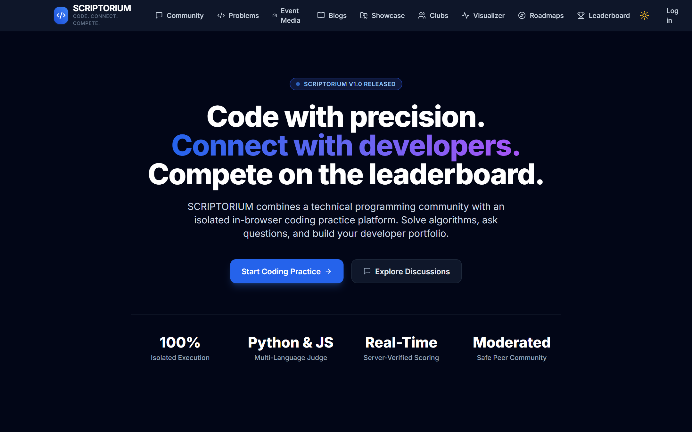

# SCRIPTORIUM — Code. Connect. Compete.

**SCRIPTORIUM** is an enterprise-grade developer ecosystem designed for students, competitive programmers, and technical software engineers. It harmoniously unifies programming practice, developer discussions, student engineering blogs, peer code reviews, campus technical clubs, event memories, and interactive learning tools into a single, cohesive dark-themed platform.



> 📸 **Visual Showcase:** A complete, organized gallery of 23 high-resolution screenshots capturing every module and workflow is available in [`screenshots/README.md`](screenshots/README.md).

---

## 🌟 Platform Highlights & Modules

### 1. 💬 Programming Discussion Forum
- **StackOverflow-Style Q&A:** Full Markdown support with live preview, syntax-highlighted code blocks, and tag taxonomy.
- **Collaborative Knowledge Base:** Upvoting/downvoting with reputational constraints, accepted answer mark by question author, and threaded discussion comments.
- **Search & Filtering:** Sort by Newest, Most Active, or Most Voted; filter by programming languages and specialized domains (DSA, AI/ML, OS, Networks, Web Dev).

### 2. ⚡ Online Coding Practice & Judge Sandbox
- **Curated Problem Library:** Difficulty-tiered algorithmic challenges (Easy, Medium, Hard) with input/output specifications, time/memory constraints, and sample cases.
- **In-Browser Monaco Editor:** VS Code-grade coding experience supporting Python, C++, Java, and JavaScript.
- **Isolated Execution Engine:** Decoupled provider-adapter architecture supporting deterministic test evaluation and sandboxed Judge0 execution with strict resource limits (128 MB RAM, 5s CPU wall-clock).
- **Server-Verified Progress & Leaderboard:** Tamper-proof solve states, difficulty-weighted scoring, and live global rankings.

### 3. 🤖 AI Mentor Progressive Hints System
- **Pedagogical Hint Hierarchy:** Rather than spoiling complete answers, problems provide 4 progressive tiers of guided problem-solving:
  - **Level 1 (Intuition):** Conceptual high-level angle and real-world analogy.
  - **Level 2 (Approach):** Optimal algorithmic strategy and data structures to consider.
  - **Level 3 (Pitfalls):** Critical edge cases, off-by-one errors, and boundary conditions.
  - **Level 4 (Scaffold):** Structured pseudo-code framework ready for implementation.

### 4. 📊 Interactive Data Structures & Algorithms Visualizer
- **Visual Algorithm Execution:** Step-by-step state animations with color-coded legends (comparing, swapping, sorted, unsorted).
- **Supported Algorithms:** Bubble Sort, Selection Sort, Insertion Sort, and Binary Search Tree (BST) construction.
- **Player Controls:** Play, pause, step forward, step backward, dynamic speed sliders (0.5x to 3x), and custom array generation.

### 5. 🗺️ Engineering Learning Hub & Roadmaps
- **Curated Career Paths:** Structured tracks for *Algorithmic Mastery*, *Full-Stack Architecture*, and *Machine Learning Foundations*.
- **Milestone Tracking:** Step-by-step module breakdown, estimated study hours, and direct links to hands-on practice problems.

### 6. 📸 Event Media & Memories
- **Rich Card-Based Gallery:** High-resolution coverage of hackathons, coding contests, seminars, and club activities.
- **Album Hierarchy & Lightbox Viewer:** Filter by year, category, and club; full-screen responsive lightbox with keyboard navigation.
- **Secure Media Storage Pipeline:** Magic-byte header verification, MIME whitelist, size gating (10MB image, 50MB video), and path sanitization.

### 7. ✍️ Student Blogs & Technical Writing
- **Student-Driven Knowledge Sharing:** Technical tutorials, project post-mortems, and career guides.
- **Rich Publishing Suite:** Featured cover images, estimated reading time computation, tag indexing, like counters, and community comments.
- **Author Recognition:** Published articles link directly to public author profiles with contribution breakdowns.

### 8. 📅 Editorial Cadence & Review Desk
- **Cadence Gap Detection:** Automated monitoring alerts editors when publishing cadence slows or gaps exceed 7 days.
- **Editorial Review Queue:** Moderator and admin approval workflow (Approve, Request Changes, Reschedule, Reject) with publication scheduling.
- **Category Manager:** Centralized category administration for technical writing topics.

### 9. 🚀 Project Showcase & Peer Code Reviews
- **Portfolio Showcase:** Public student showcase cards with live demo links, GitHub repositories, tech stack badges, and screenshots.
- **Structured 4-Pillar Peer Reviews:** Code inspection rubrics evaluating:
  - 🏗️ **Architecture & Design:** Code structure, modularity, patterns.
  - ⚡ **Performance & Efficiency:** Complexity, resource usage, caching.
  - 🔒 **Security & Reliability:** Input sanitization, error handling, auth.
  - 🎨 **UI/UX & Accessibility:** Usability, responsiveness, aesthetics.
- **Threaded Code Discussions:** Inline code snippet commenting and review resolution lifecycle (`OPEN`, `ADDRESSED`, `RESOLVED`).

### 10. 🛡️ Technical Clubs & Genuine Achievements
- **Campus Club Directory:** Discover student guilds (Open Source Guild, Competitive Programming, AI Society) with officer directories and join/leave membership.
- **Broadcast Announcements:** Officer communication feed with pinned priority announcements.
- **Authentic Dynamic Badges:** Server-computed achievements derived directly from authentic database activity:
  - 🏆 *Project Creator*, 🔍 *Code Inspector*, 🎖️ *Prolific Reviewer*, ✍️ *Tech Writer*, ⚡ *Algorithm Solver*, 🏛️ *Community Pillar*.
  - Tiers: Bronze, Silver, Gold, Diamond.

### 11. 🔒 Role-Based Access Control & Moderation Suite
- **Granular Permissions:** Four primary tiers: `Guest`, `User`, `Moderator`, and `Administrator`.
- **Content Reporting & Triage:** Centralized queue for reporting abusive questions, comments, or projects.
- **Audit Logging:** Server-side audit logging of all administrative actions.

---

## 🛠️ Technology Stack

| Layer | Technologies |
|---|---|
| **Frontend** | React 18, TypeScript, Vite, Tailwind CSS, Monaco Editor (`@monaco-editor/react`), Lucide React, React Router 6 |
| **Backend** | Python 3.10+, Flask (Application Factory & Blueprints), SQLAlchemy 2.0 ORM, Flask-Migrate, Flask-CORS, Pytest |
| **Database** | MySQL 8 (`utf8mb4`) with SQLite fallback for rapid offline development and zero-configuration testing |
| **Code Execution** | Provider-adapter architecture with `MockJudgeAdapter` for deterministic testing and `Judge0Adapter` for sandboxed multi-language execution |
| **Security & Auth** | Salted password hashing (Werkzeug/bcrypt), stateless JWT tokens + secure HttpOnly cookies, parameterized SQL, magic-byte media inspection |

---

## 🚀 Quick Start (Local Setup)

### Prerequisites
- **Python:** 3.10 or higher
- **Node.js:** 18 or higher (with npm)
- **Git**

---

### 1. Clone the Repository
```bash
git clone https://github.com/Gurwinder12B/Scriptorium-Code.Connect.Compete.git
cd Scriptorium-Code.Connect.Compete
```

---

### 2. Backend Setup
```bash
cd backend

# Create and activate Python virtual environment
python -m venv .venv

# Windows:
.venv\Scripts\activate
# Linux / macOS:
# source .venv/bin/activate

# Install dependencies
pip install -r requirements.txt

# Configure environment variables
cp ../.env.example .env

# Initialize database and seed sample data
python seed.py

# Run backend test suite (all 30 tests pass)
pytest backend/tests -v

# Start the Flask API server (runs at http://127.0.0.1:5000/api/v1)
python run.py
```

---

### 3. Frontend Setup
```bash
# In a new terminal window:
cd frontend

# Install Node dependencies
npm install

# Build for production verification
npm run build

# Start the Vite development server (runs at http://127.0.0.1:5173)
npm run dev -- --host 127.0.0.1
```

Open your browser and navigate to **`http://127.0.0.1:5173/`**.

---

## 🔑 Default Seed Accounts

Running `python backend/seed.py` creates pre-populated test accounts ready for evaluation:

| Role | Username | Password | Privileges |
|---|---|---|---|
| **Administrator** | `admin` | `Admin123!` | Full system access, Editorial Desk, Club creation, Admin dashboard, Role assignment |
| **Moderator** | `moderator` | `Mod123!` | Moderation queues, Editorial review, Event management |
| **Developer** | `developer` | `User123!` | Project creator, Code reviewer, Discussion contributor, Club officer |
| **Student** | `student` | `User123!` | Practice problems, Club member, Discussion explorer, Blog author |

---

## 📡 REST API Reference Summary

All endpoints are prefixed with `/api/v1`:

| Blueprint | Route Prefix | Key Endpoints | Description |
|---|---|---|---|
| **Auth** | `/auth` | `/register`, `/login`, `/me`, `/logout` | JWT auth & user profile |
| **Users** | `/users` | `/profile/<username>` | User statistics, published articles, genuine badges |
| **Community** | `/community` | `/questions`, `/questions/<id>`, `/answers`, `/votes` | Discussion forum & voting |
| **Problems** | `/problems` | `/problems`, `/problems/<id>`, `/problems/<id>/hints` | Coding challenges & 4-tier AI hints |
| **Submissions** | `/submissions` | `/submissions`, `/submissions/<id>` | Code execution and judging |
| **Progress** | `/progress` | `/summary`, `/stats` | Verified solve progress |
| **Leaderboard**| `/leaderboard` | `/` | Global rankings and points |
| **Events** | `/events` | `/events`, `/events/<id>/albums`, `/events/<id>/media` | Event memories and gallery |
| **Blogs** | `/blogs` | `/blogs`, `/blogs/<id>/like`, `/editorial/calendar` | Student writing & editorial desk |
| **Projects** | `/projects` | `/projects`, `/projects/<id>/reviews`, `/reviews/<id>/comments` | Showcase & 4-pillar peer reviews |
| **Clubs** | `/clubs` | `/clubs`, `/clubs/<id>/membership`, `/announcements` | Student clubs & broadcasts |
| **Moderation** | `/moderation` | `/reports`, `/resolve` | Content reports & moderation |
| **Admin** | `/admin` | `/stats`, `/users`, `/audit-logs` | Platform metrics & user roles |
| **Media** | `/media` | `/upload`, `/uploads/<filename>` | Secure validated file storage |

---

## 📚 Project Documentation

Detailed architecture specifications are maintained in the [`docs/`](docs/) directory:

- [Product Requirements Document (PRD.md)](docs/PRD.md)
- [Software Requirements Specification (SRS.md)](docs/SRS.md)
- [System Architecture (ARCHITECTURE.md)](docs/ARCHITECTURE.md)
- [System Design (Systemdesign.md)](docs/Systemdesign.md)
- [Technical Design Document (TDD.md)](docs/TDD.md)
- [REST API Specification (API.md)](docs/API.md)
- [Database Schema Specification (DATABASE.md)](docs/DATABASE.md)
- [Development Phases (Phases.md)](docs/Phases.md)
- [Test Plan & Verification (TEST-PLAN.md)](docs/TEST-PLAN.md)
- [Architectural Decisions Log (DECISIONS.md)](docs/DECISIONS.md)

---

## 🧪 Testing & Verification

The project includes an automated test suite across backend and frontend:

- **Backend Pytest Suite:**
  ```bash
  backend\.venv\Scripts\pytest backend\tests -v
  # 30 passed in ~25s
  ```
- **Frontend TypeScript & Build Verification:**
  ```bash
  cd frontend
  npm run build
  # tsc && vite build -> 0 errors, production bundle generated
  ```

---

## 📄 License

This project is licensed under the MIT License — see the [LICENSE](LICENSE) file for details.
