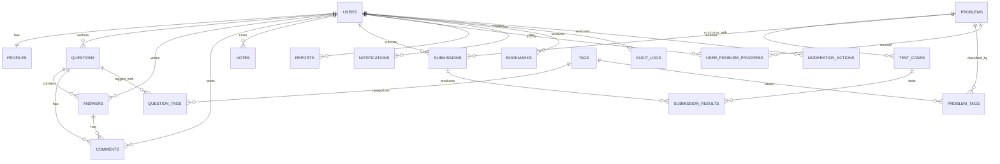

# SCRIPTORIUM — Database Design Specification (DATABASE.md)

**Document Version:** 1.0  
**Date:** 4 November 2026  
**Status:** Approved Schema Specification  
**Database Management System:** MySQL 8.0+ / InnoDB (UTF-8 `utf8mb4_unicode_ci`)  
**ORM / Migration Engine:** SQLAlchemy + Flask-Migrate (Alembic)  

---

## 1. Entity-Relationship Diagram

---

## 2. Table Specifications

### 2.1 `users`
Core account credential and role record.

| Column | Type | Constraints | Description |
|---|---|---|---|
| `id` | INTEGER | PRIMARY KEY, AUTO_INCREMENT | Unique user identifier |
| `username` | VARCHAR(50) | UNIQUE, NOT NULL, INDEX | Unique handle (alphanumeric + underscores) |
| `email` | VARCHAR(255) | UNIQUE, NOT NULL, INDEX | Unique email address |
| `password_hash` | VARCHAR(255) | NOT NULL | Salted PBKDF2/bcrypt password hash |
| `role` | VARCHAR(20) | NOT NULL, DEFAULT 'user' | Role: `guest`, `user`, `moderator`, `admin` |
| `is_active` | BOOLEAN | NOT NULL, DEFAULT TRUE | Soft-disable / suspension flag |
| `created_at` | DATETIME | NOT NULL, DEFAULT UTC_NOW | Account creation timestamp |
| `updated_at` | DATETIME | NOT NULL, DEFAULT UTC_NOW | Last account update timestamp |

### 2.2 `profiles`
Public profile details and aggregated user statistics.

| Column | Type | Constraints | Description |
|---|---|---|---|
| `id` | INTEGER | PRIMARY KEY, AUTO_INCREMENT | Profile ID |
| `user_id` | INTEGER | UNIQUE, NOT NULL, FK(`users.id` ON DELETE CASCADE) | Linked account |
| `full_name` | VARCHAR(100) | NULLABLE | Real or preferred display name |
| `bio` | TEXT | NULLABLE | Short biography or learning goals |
| `location` | VARCHAR(100) | NULLABLE | Geographic location or university |
| `github_url` | VARCHAR(255) | NULLABLE | GitHub profile URL |
| `website_url` | VARCHAR(255) | NULLABLE | Personal blog / portfolio URL |
| `avatar_url` | VARCHAR(255) | NULLABLE | Avatar image path or Gravatar |
| `points` | INTEGER | NOT NULL, DEFAULT 0, INDEX | Gamification points (solved + reputation) |
| `problems_solved_count` | INTEGER | NOT NULL, DEFAULT 0 | Count of unique problems solved |
| `questions_count` | INTEGER | NOT NULL, DEFAULT 0 | Count of questions asked |
| `answers_count` | INTEGER | NOT NULL, DEFAULT 0 | Count of answers contributed |
| `updated_at` | DATETIME | NOT NULL, DEFAULT UTC_NOW | Profile update timestamp |

### 2.3 `questions`
Community technical questions.

| Column | Type | Constraints | Description |
|---|---|---|---|
| `id` | INTEGER | PRIMARY KEY, AUTO_INCREMENT | Question ID |
| `author_id` | INTEGER | NOT NULL, FK(`users.id` ON DELETE CASCADE), INDEX | Author ID |
| `title` | VARCHAR(255) | NOT NULL, INDEX | Descriptive question title |
| `slug` | VARCHAR(280) | UNIQUE, NOT NULL, INDEX | URL-safe slug |
| `content_markdown` | MEDIUMTEXT | NOT NULL | Safe Markdown question body with code blocks |
| `is_solved` | BOOLEAN | NOT NULL, DEFAULT FALSE | Whether an answer was accepted |
| `accepted_answer_id` | INTEGER | NULLABLE, FK(`answers.id` ON DELETE SET NULL) | Accepted answer reference |
| `vote_count` | INTEGER | NOT NULL, DEFAULT 0, INDEX | Cached net votes (upvotes - downvotes) |
| `answer_count` | INTEGER | NOT NULL, DEFAULT 0 | Cached answer count |
| `view_count` | INTEGER | NOT NULL, DEFAULT 0 | Number of times viewed |
| `is_hidden` | BOOLEAN | NOT NULL, DEFAULT FALSE | Soft-deletion or moderation flag |
| `created_at` | DATETIME | NOT NULL, DEFAULT UTC_NOW, INDEX | Publication timestamp |
| `updated_at` | DATETIME | NOT NULL, DEFAULT UTC_NOW | Last modified timestamp |

### 2.4 `answers`
Responses to community questions.

| Column | Type | Constraints | Description |
|---|---|---|---|
| `id` | INTEGER | PRIMARY KEY, AUTO_INCREMENT | Answer ID |
| `question_id` | INTEGER | NOT NULL, FK(`questions.id` ON DELETE CASCADE), INDEX | Linked question |
| `author_id` | INTEGER | NOT NULL, FK(`users.id` ON DELETE CASCADE), INDEX | Answer author |
| `content_markdown` | MEDIUMTEXT | NOT NULL | Markdown content |
| `is_accepted` | BOOLEAN | NOT NULL, DEFAULT FALSE | Accepted by question author flag |
| `vote_count` | INTEGER | NOT NULL, DEFAULT 0, INDEX | Cached net votes |
| `is_hidden` | BOOLEAN | NOT NULL, DEFAULT FALSE | Moderation hide flag |
| `created_at` | DATETIME | NOT NULL, DEFAULT UTC_NOW | Timestamp |
| `updated_at` | DATETIME | NOT NULL, DEFAULT UTC_NOW | Timestamp |

### 2.5 `comments`
Short conversational remarks on questions or answers.

| Column | Type | Constraints | Description |
|---|---|---|---|
| `id` | INTEGER | PRIMARY KEY, AUTO_INCREMENT | Comment ID |
| `author_id` | INTEGER | NOT NULL, FK(`users.id` ON DELETE CASCADE), INDEX | Commenter |
| `target_type` | VARCHAR(20) | NOT NULL | `question` or `answer` |
| `target_id` | INTEGER | NOT NULL, INDEX | Target entity ID |
| `content` | TEXT | NOT NULL | Plain text or inline code snippet |
| `is_hidden` | BOOLEAN | NOT NULL, DEFAULT FALSE | Moderation flag |
| `created_at` | DATETIME | NOT NULL, DEFAULT UTC_NOW | Timestamp |

### 2.6 `tags` & `question_tags`
Topic tags for questions and categorization.

| Column | Type | Constraints | Description |
|---|---|---|---|
| `id` | INTEGER | PRIMARY KEY, AUTO_INCREMENT | Tag ID |
| `name` | VARCHAR(50) | UNIQUE, NOT NULL, INDEX | Tag label (e.g., `python`, `algorithms`) |
| `slug` | VARCHAR(60) | UNIQUE, NOT NULL | Slugified name |
| `description` | VARCHAR(255) | NULLABLE | Brief tag explanation |
| `usage_count` | INTEGER | NOT NULL, DEFAULT 0 | Count of tagged questions |
| `created_at` | DATETIME | NOT NULL, DEFAULT UTC_NOW | Timestamp |

**`question_tags`** compound key: `(question_id, tag_id)` with cascading foreign keys.

### 2.7 `votes`
Voting records for questions and answers.

| Column | Type | Constraints | Description |
|---|---|---|---|
| `id` | INTEGER | PRIMARY KEY, AUTO_INCREMENT | Vote record ID |
| `user_id` | INTEGER | NOT NULL, FK(`users.id` ON DELETE CASCADE) | Voter |
| `target_type` | VARCHAR(20) | NOT NULL | `question` or `answer` |
| `target_id` | INTEGER | NOT NULL | Target entity ID |
| `value` | SMALLINT | NOT NULL | `+1` (upvote) or `-1` (downvote) |
| `created_at` | DATETIME | NOT NULL, DEFAULT UTC_NOW | Vote timestamp |

*Unique compound constraint:* `UNIQUE(user_id, target_type, target_id)`.

### 2.8 `problems`
Coding practice challenges.

| Column | Type | Constraints | Description |
|---|---|---|---|
| `id` | INTEGER | PRIMARY KEY, AUTO_INCREMENT | Problem ID |
| `title` | VARCHAR(200) | NOT NULL, INDEX | Problem title |
| `slug` | VARCHAR(220) | UNIQUE, NOT NULL, INDEX | URL slug |
| `difficulty` | VARCHAR(20) | NOT NULL, DEFAULT 'EASY', INDEX | `EASY`, `MEDIUM`, `HARD` |
| `description_markdown`| MEDIUMTEXT | NOT NULL | Problem statement and requirements |
| `input_format` | TEXT | NOT NULL | Specification of inputs |
| `output_format` | TEXT | NOT NULL | Specification of outputs |
| `constraints` | TEXT | NOT NULL | Limits (e.g. $1 \le N \le 10^5$) |
| `time_limit_ms` | INTEGER | NOT NULL, DEFAULT 2000 | Wall clock limit in ms |
| `memory_limit_mb` | INTEGER | NOT NULL, DEFAULT 128 | Memory limit in MB |
| `starter_templates` | JSON | NOT NULL | Starter templates per language |
| `is_published` | BOOLEAN | NOT NULL, DEFAULT TRUE | Active in library flag |
| `acceptance_rate` | FLOAT | NOT NULL, DEFAULT 0.0 | Calculated acceptance percentage |
| `total_submissions` | INTEGER | NOT NULL, DEFAULT 0 | Total submitted attempts |
| `accepted_submissions`| INTEGER | NOT NULL, DEFAULT 0 | Count of accepted submissions |
| `created_by` | INTEGER | NULLABLE, FK(`users.id` ON DELETE SET NULL) | Author/Setter |
| `created_at` | DATETIME | NOT NULL, DEFAULT UTC_NOW | Timestamp |
| `updated_at` | DATETIME | NOT NULL, DEFAULT UTC_NOW | Timestamp |

### 2.9 `problem_tags`
Many-to-many relationship linking `problems` to `tags`. Compound key: `(problem_id, tag_id)`.

### 2.10 `test_cases`
Evaluation test cases for problems.

| Column | Type | Constraints | Description |
|---|---|---|---|
| `id` | INTEGER | PRIMARY KEY, AUTO_INCREMENT | Test case ID |
| `problem_id` | INTEGER | NOT NULL, FK(`problems.id` ON DELETE CASCADE), INDEX | Parent problem |
| `input_data` | MEDIUMTEXT | NOT NULL | Input passed via stdin |
| `expected_output` | MEDIUMTEXT | NOT NULL | Expected stdout output |
| `is_sample` | BOOLEAN | NOT NULL, DEFAULT FALSE | Whether shown on problem page |
| `is_hidden` | BOOLEAN | NOT NULL, DEFAULT FALSE | Secret judge test case |
| `explanation` | TEXT | NULLABLE | Explanation for sample cases |
| `order_index` | INTEGER | NOT NULL, DEFAULT 0 | Display and execution order |
| `created_at` | DATETIME | NOT NULL, DEFAULT UTC_NOW | Creation timestamp |

*Security Rule:* Columns `input_data` and `expected_output` for hidden test cases (`is_hidden = TRUE`) MUST NEVER be returned by public APIs.

### 2.11 `submissions` & `submission_results`
User code submissions and execution logs.

**`submissions`**
| Column | Type | Constraints | Description |
|---|---|---|---|
| `id` | INTEGER | PRIMARY KEY, AUTO_INCREMENT | Submission ID |
| `problem_id` | INTEGER | NOT NULL, FK(`problems.id` ON DELETE CASCADE), INDEX | Target problem |
| `user_id` | INTEGER | NOT NULL, FK(`users.id` ON DELETE CASCADE), INDEX | Submitting user |
| `language` | VARCHAR(30) | NOT NULL | `python`, `javascript`, `cpp` |
| `source_code` | MEDIUMTEXT | NOT NULL | Full submitted code |
| `status` | VARCHAR(30) | NOT NULL, DEFAULT 'QUEUED', INDEX | Verdict state |
| `execution_time_ms` | INTEGER | NULLABLE | Maximum execution time across test cases |
| `memory_used_kb` | INTEGER | NULLABLE | Maximum memory consumed |
| `error_message` | TEXT | NULLABLE | Compiler or runtime error message |
| `stdout_sample` | TEXT | NULLABLE | Permitted stdout feedback for public test cases |
| `is_simulated` | BOOLEAN | NOT NULL, DEFAULT FALSE | True if evaluated with MockJudgeAdapter |
| `created_at` | DATETIME | NOT NULL, DEFAULT UTC_NOW, INDEX | Submission timestamp |
| `updated_at` | DATETIME | NOT NULL, DEFAULT UTC_NOW | Status resolution timestamp |

**`submission_results`**
Detailed per-test-case verdict breakdown.

| Column | Type | Constraints | Description |
|---|---|---|---|
| `id` | INTEGER | PRIMARY KEY, AUTO_INCREMENT | Result ID |
| `submission_id` | INTEGER | NOT NULL, FK(`submissions.id` ON DELETE CASCADE), INDEX | Linked submission |
| `test_case_id` | INTEGER | NOT NULL, FK(`test_cases.id` ON DELETE CASCADE) | Test case evaluated |
| `verdict` | VARCHAR(30) | NOT NULL | `ACCEPTED`, `WRONG_ANSWER`, `TIME_LIMIT_EXCEEDED`, etc. |
| `execution_time_ms` | INTEGER | NULLABLE | Runtime in ms |
| `memory_used_kb` | INTEGER | NULLABLE | Memory in KB |
| `actual_output` | TEXT | NULLABLE | Actual stdout (truncated/omitted for hidden cases) |
| `error_details` | TEXT | NULLABLE | Stderr or signal details |

### 2.12 `user_problem_progress`
Tracks unique problem solving progress per user.

| Column | Type | Constraints | Description |
|---|---|---|---|
| `id` | INTEGER | PRIMARY KEY, AUTO_INCREMENT | Progress ID |
| `user_id` | INTEGER | NOT NULL, FK(`users.id` ON DELETE CASCADE) | User ID |
| `problem_id` | INTEGER | NOT NULL, FK(`problems.id` ON DELETE CASCADE) | Problem ID |
| `status` | VARCHAR(20) | NOT NULL, DEFAULT 'ATTEMPTED' | `ATTEMPTED` or `SOLVED` |
| `total_attempts` | INTEGER | NOT NULL, DEFAULT 1 | Attempt counter |
| `first_solved_at` | DATETIME | NULLABLE | Timestamp of first Accepted verdict |
| `last_attempted_at`| DATETIME | NOT NULL, DEFAULT UTC_NOW | Most recent submission timestamp |

*Unique compound constraint:* `UNIQUE(user_id, problem_id)`.

### 2.13 `reports` & `moderation_actions`
Community content reporting and moderator audit trail.

**`reports`**
- `id`, `reporter_id`, `target_type` (`question`, `answer`, `comment`), `target_id`, `reason` (`spam`, `harassment`, `inappropriate`, `low_quality`), `details`, `status` (`PENDING`, `REVIEWED`, `DISMISSED`, `ACTION_TAKEN`), `reviewed_by`, `reviewed_at`, `created_at`.

**`moderation_actions`**
- `id`, `moderator_id`, `action_type` (`HIDE_CONTENT`, `RESTORE_CONTENT`, `SUSPEND_USER`, `UNSUSPEND_USER`), `target_type`, `target_id`, `reason`, `created_at`.

### 2.14 `notifications`
In-app user notifications.
- `id`, `user_id`, `actor_id`, `event_type` (`ANSWER_POSTED`, `COMMENT_POSTED`, `ANSWER_ACCEPTED`, `UPVOTE_RECEIVED`, `SUBMISSION_VERDICT`), `title`, `message`, `link_url`, `is_read`, `created_at`.

### 2.15 `bookmarks`
User saved questions or problems.
- `id`, `user_id`, `target_type` (`question`, `problem`), `target_id`, `created_at`. Compound unique `(user_id, target_type, target_id)`.

### 2.16 `audit_logs`
Security and administrative tracking.
- `id`, `user_id`, `action`, `resource_type`, `resource_id`, `ip_address`, `user_agent`, `details_json`, `created_at`.

---

## 3. Database Indexes Strategy

To guarantee rapid queries under production scale:
- `users(email)`, `users(username)` — Unique indexes for fast auth lookups.
- `questions(created_at)`, `questions(vote_count)`, `questions(author_id)` — High-speed feed queries, sorting, and user profile listings.
- `answers(question_id, vote_count)` — Sorted answer retrieval per question.
- `problems(difficulty, is_published)` — Filtered problem catalog queries.
- `submissions(user_id, created_at)`, `submissions(problem_id, status)` — Fast user submission history and problem statistics.
- `user_problem_progress(user_id, status)` — Real-time progress dashboard computations.
