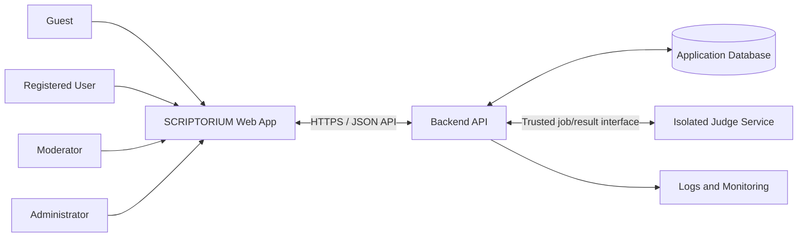
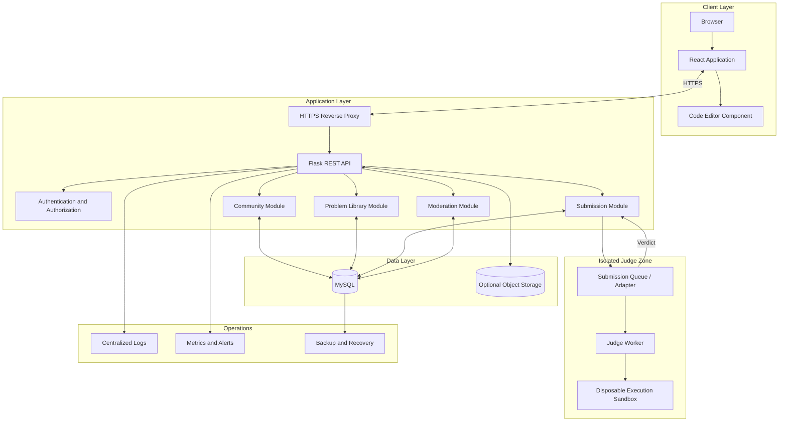
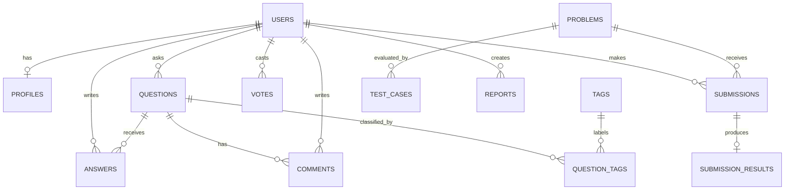
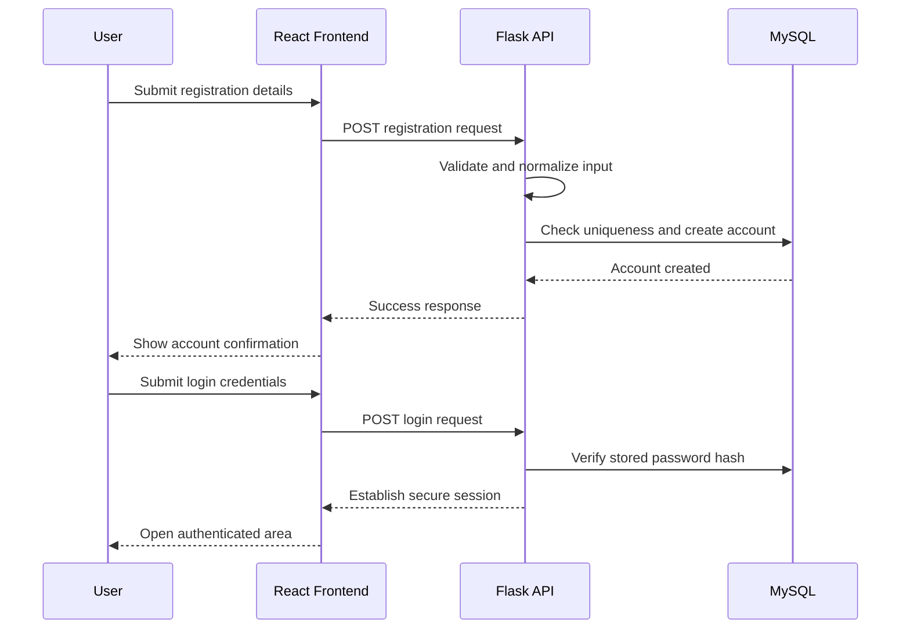
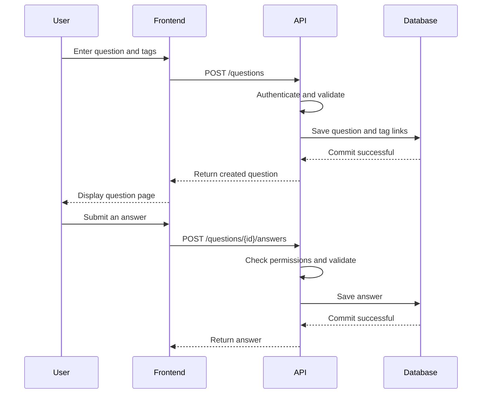
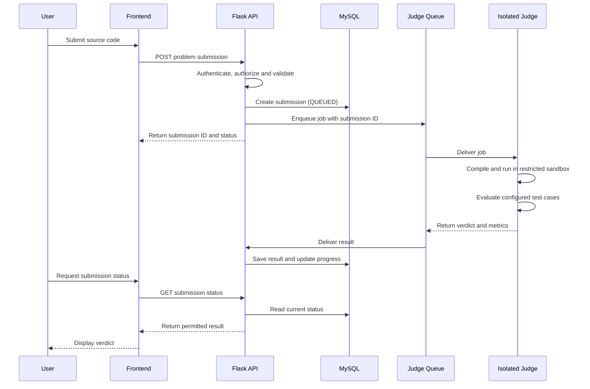
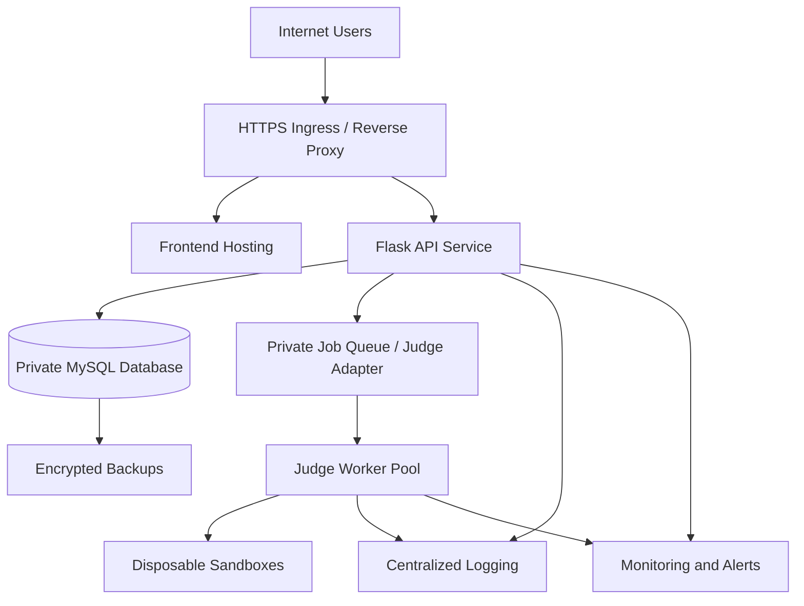

# SCRIPTORIUM — System Design Document

**Document version:** 1.0  
**Date:** 4 November 2026  
**Project:** SCRIPTORIUM — Code. Connect. Compete.  
**Status:** Draft design baseline

---

## 1. Purpose

This document describes the system-level design of SCRIPTORIUM: its major components, responsibilities, communication patterns, data flows, security boundaries, deployment topology and scaling approach.

SCRIPTORIUM combines a programming discussion community with an online coding-practice platform. This document explains how those capabilities fit together as one system.

It complements:
- `PRD.md` — product goals, users and scope.
- `SRS.md` — functional and non-functional requirements.
- `TDD.md` — implementation-level technical decisions.
- `Phases.md` — development order and milestones.

This is a proposed design baseline. It should be reviewed and updated as implementation decisions are confirmed.

## 2. System Goals

The system is designed to:

1. Provide one account and consistent experience for community and coding practice.
2. Support questions, answers, comments, tags, votes and moderation.
3. Provide a searchable library of programming problems.
4. Accept source-code submissions and return reliable judging results.
5. Track user activity and coding progress.
6. Protect accounts, content, private data and hidden test cases.
7. Support gradual growth without requiring a complex distributed system on day one.
8. Keep dangerous code execution isolated from the public-facing web application.

## 3. Scope and Design Boundaries

### 3.1 Included subsystems

- Web frontend.
- Backend REST API.
- Authentication and authorization.
- Relational database.
- Community module.
- Problem-library module.
- Submission management.
- External or separately deployed code-judging service.
- Moderation and administration.
- Logging, monitoring and backup processes.

### 3.2 Excluded from the initial design

- General-purpose cloud development environments.
- Unrestricted internet access from submitted programs.
- Native mobile applications.
- Payment processing.
- Large-scale microservices architecture.
- Real-time collaborative editing.

These may be considered in future releases if supported by user needs and operational capacity.

## 4. System Context

The system has four main actors:

| Actor | Main interaction |
|---|---|
| Guest | Browse public pages and public problems |
| Registered user | Ask and answer questions, vote, solve problems and view progress |
| Moderator | Review reports and moderate community content |
| Administrator | Manage users, roles, problems and platform configuration |

### 4.1 Context diagram

The browser is an untrusted client. All permissions, validation and business rules must be enforced by the backend.

## 5. High-Level Architecture

Use a modular client-server architecture with a separately isolated judge subsystem.

### 5.1 Architectural style

- **Frontend:** single-page React application.
- **Backend:** modular monolith using Flask Blueprints and service layers.
- **Database:** relational MySQL database.
- **Code judging:** isolated worker/service boundary.
- **Communication:** HTTPS REST/JSON for browser-to-backend; trusted internal communication for judge jobs and results.
- **Deployment:** start with a manageable deployment and separate the judge execution environment from the web application.

A modular monolith is appropriate for the initial product because it keeps development and deployment understandable while preserving module boundaries. Microservices should not be introduced without a concrete scaling or ownership need.

## 6. Component Responsibilities

### 6.1 Frontend application

Responsibilities:
- Render public, user, moderator and administrator screens.
- Manage navigation and temporary interface state.
- Validate forms for immediate user feedback.
- Call backend endpoints through a centralized API client.
- Display community content, problem statements and submission results.
- Host the browser code editor.

The frontend must not:
- Connect directly to MySQL.
- Store database or judge credentials.
- decide whether a user is authorized to perform a protected action.
- Determine an official submission verdict.

### 6.2 Backend API

Responsibilities:
- Authenticate requests.
- Enforce role and ownership permissions.
- Validate and normalize user input.
- Apply business rules.
- Read and write application data.
- Create and track submissions.
- Coordinate with the judge service.
- Return consistent responses.
- Record security-relevant events.

### 6.3 Database

Responsibilities:
- Persist account and profile data.
- Persist questions, answers, comments, tags and votes.
- Persist problems and test-case metadata.
- Persist submissions, results and progress.
- Persist reports and audit records.

The database is the source of truth for application state. The browser must not be treated as a trusted source for votes, roles, verdicts or progress totals.

### 6.4 Judge subsystem

Responsibilities:
- Receive a validated job.
- Select an approved language runtime.
- Compile and/or execute code in a disposable sandbox.
- Apply execution limits.
- Compare output with configured test cases.
- Return a structured verdict and resource metrics.

The judge subsystem must be independently restricted. It should not have broad access to the application database or user account information.

## 7. Logical Backend Modules

| Module | Owns | Example operations |
|---|---|---|
| Authentication | Identity and session lifecycle | Register, login, logout |
| Users | Profiles and user settings | View and update profile |
| Community | Questions, answers, comments, tags and votes | Create question, answer, vote |
| Problems | Problem metadata and statements | List and view problem |
| Submissions | Submission lifecycle and results | Create submission, retrieve verdict |
| Progress | User solving history and statistics | Mark problem solved, calculate progress |
| Moderation | Reports and moderation actions | Review report, hide content |
| Administration | Platform-level management | Manage roles and problem setters |
| Notifications | In-app event notifications | Create and mark notification read |

Modules may share the same Flask deployment initially, but they should communicate through defined service interfaces rather than importing each other's internal implementation indiscriminately.

## 8. Main Data Model

The detailed schema belongs in `DATABASE.md`. At system level, the major relationships are:

### 8.1 Data ownership

- A user owns their profile fields and authored content, subject to platform rules.
- Moderators can act only within their assigned permissions.
- Administrators manage platform-level records.
- Official problem statements and test cases are managed by authorized problem setters or administrators.
- Judge results are system-generated and cannot be edited by ordinary users.

### 8.2 Data integrity

Use primary keys, foreign keys, unique constraints, transactions and indexes. Define deletion and retention behavior deliberately. Store timestamps consistently, preferably in UTC, and convert them for display at the client.

## 9. Key System Workflows

### 9.1 User registration and login

Security notes:
- Hash passwords with a trusted password-hashing library.
- Apply rate limits to authentication endpoints.
- Use secure session cookies or a carefully designed token strategy.
- Protect state-changing cookie-authenticated requests against CSRF.
- Do not reveal whether an account exists in sensitive recovery flows.

### 9.2 Ask and answer a community question

### 9.3 Code submission and judging

The browser should not wait for a long-running judge operation inside the original HTTP request. The API creates a submission and returns an identifier; the frontend retrieves status separately.

### 9.4 Moderation workflow

1. A user reports a question, answer or comment.
2. The backend validates the report and stores it.
3. An authorized moderator opens the moderation queue.
4. The moderator reviews the reported item and context.
5. The moderator takes an allowed action.
6. The backend records the action in an audit log.
7. The content state and relevant user notification are updated.

## 10. Code-Judging Security Boundary

<badge color="danger">Highest-risk subsystem</badge>

Submitted source code is hostile, untrusted input. The judge is the only subsystem allowed to execute it.

### 10.1 Trust zones

| Zone | Trust level | Rules |
|---|---|---|
| Browser | Untrusted | Never trust client-supplied roles, verdicts or totals |
| Public API | Controlled entry point | Validate, authenticate, authorize and rate-limit |
| Application database | Protected | Private network access and least-privilege credentials |
| Judge coordinator | Restricted internal service | Accept authenticated jobs and validate job metadata |
| Execution sandbox | Hostile workload zone | Disposable, resource-limited and isolated |
| Operations environment | Privileged | Restricted administrator access and audited changes |

### 10.2 Required sandbox controls

- Use a dedicated judge service or worker pool.
- Use disposable execution environments.
- Apply CPU, memory, wall-clock, process and output limits.
- Restrict writable filesystem paths.
- Prevent host filesystem and container-runtime socket access.
- Disable network access by default.
- Drop unnecessary privileges and capabilities.
- Apply syscall restrictions or stronger isolation where supported.
- Keep judge hosts separate from the public web application where practical.
- Clean up temporary files and environments after each job.
- Keep hidden test inputs and expected outputs private.
- Review the selected judge's actual security model; containers alone are not automatically a complete security boundary.

### 10.3 Job integrity

- Assign a unique ID to every submission.
- Authenticate internal job delivery and result callbacks.
- Make result processing idempotent.
- Validate that a returned result belongs to the expected submission.
- Allow only valid status transitions.
- Do not allow the browser to set a submission verdict.
- Handle duplicate, delayed and failed callbacks safely.

## 11. API and Communication Design

### 11.1 Browser-to-backend

- Protocol: HTTPS.
- Format: JSON for normal API requests and responses.
- Base path: `/api/v1`.
- Authentication: secure session or documented token mechanism.
- Errors: consistent machine-readable error codes and safe messages.

### 11.2 Backend-to-database

- Use SQLAlchemy or parameterized SQL.
- Use transactions for multi-record operations.
- Keep database credentials server-side.
- Use connection pooling appropriate to deployment size.
- Apply migrations through a controlled process.

### 11.3 Backend-to-judge

- Use a trusted private network or authenticated internal channel.
- Send only the data required for judging.
- Do not expose judge administration endpoints publicly.
- Apply timeouts and bounded retries.
- Use unique job IDs to prevent duplicate processing.

### 11.4 API endpoint groups

| Group | Example path |
|---|---|
| Authentication | `/api/v1/auth/...` |
| Users | `/api/v1/users/...` |
| Community | `/api/v1/questions/...` |
| Problems | `/api/v1/problems/...` |
| Submissions | `/api/v1/submissions/...` |
| Moderation | `/api/v1/reports/...` |
| Notifications | `/api/v1/notifications/...` |

The full request and response contract will be maintained in `API.md`.

## 12. Deployment Topology

### 12.1 Initial deployment

For early development, a simple deployment may contain:
- One frontend hosting target.
- One Flask API service.
- One MySQL instance.
- One separately restricted judge service.
- HTTPS reverse proxy or managed ingress.
- Basic logs and backups.

The judge must remain isolated even if the rest of the application is hosted on one development machine.

### 12.2 Production-oriented topology

The diagram is logical; a managed queue, object storage or separate frontend host may be introduced only when justified.

### 12.3 Environment separation

Maintain:
- **Development:** local development and debugging.
- **Test/CI:** automated and repeatable tests.
- **Staging:** production-like release verification.
- **Production:** real user traffic.

Use separate credentials and databases. Do not use production secrets in local development.

## 13. Scalability and Capacity Strategy

Scale only after measuring real bottlenecks.

| Component | Initial approach | Possible future improvement |
|---|---|---|
| Frontend | Static asset hosting and browser rendering | CDN and optimized bundles |
| Flask API | One or a small number of application instances | Multiple stateless API instances |
| MySQL | Indexed relational database | Read replicas, tuning or managed database |
| Judge | Bounded worker capacity | Independently scaled worker pool |
| Search | MySQL indexes and text search | Dedicated search engine if needed |
| Notifications | Database-backed in-app notifications | Background notification workers |
| File storage | Local development storage | Private object storage |

Important principles:
- Paginate large lists.
- Index measured query patterns.
- Avoid N+1 queries.
- Keep judging asynchronous.
- Set request and submission size limits.
- Apply per-user and per-IP rate limits where appropriate.
- Monitor judge queue depth and execution resource use.

## 14. Availability and Failure Handling

| Failure | Expected system behavior |
|---|---|
| Frontend unavailable | Backend data remains intact; show service status when possible |
| API unavailable | Show a safe error and allow retry |
| Database unavailable | Fail safely; do not report false success |
| Judge unavailable | Keep submission pending or mark a controlled service error; do not invent a verdict |
| Job callback duplicated | Idempotent processing prevents duplicate progress updates |
| Job times out | Return a defined timeout or service state |
| Network interruption | User can retrieve submission status later |
| Backup failure | Alert operators and investigate; do not assume recovery is possible |

Do not silently convert infrastructure errors into `WRONG_ANSWER` or `ACCEPTED`.

## 15. Security and Privacy Design

### 15.1 Application security
- Validate all input on the server.
- Use parameterized database queries.
- Escape output and safely render supported Markdown.
- Enforce ownership and role checks on every protected operation.
- Apply CSRF protections where applicable.
- Configure secure cookies and HTTPS.
- Rate-limit abuse-prone endpoints.
- Keep secrets out of source control.
- Keep dependencies updated and review security advisories.

### 15.2 Data privacy
- Collect only data required for the product.
- Return only fields a caller is allowed to see.
- Restrict access to private profile data and moderation records.
- Keep hidden judge tests private.
- Define retention and deletion policies.
- Avoid logging passwords, tokens, hidden tests or unnecessary personal data.

### 15.3 Administrative security
- Restrict administrator accounts.
- Require strong authentication practices.
- Audit role changes, account suspensions and content moderation.
- Separate routine moderator permissions from platform-wide administrator permissions.

## 16. Observability

Monitor the system using structured logs, metrics and alerts.

### Important measurements
- API request count, latency and error rate.
- Authentication failure and rate-limit counts.
- Database connection usage and slow queries.
- Submission queue depth and waiting time.
- Judge execution duration and verdict distribution.
- Judge worker failures and resource utilization.
- Backup completion and restore-test status.

Logs should include a request or submission correlation ID where useful, but must not include secrets or hidden test content. Restrict log access and define retention periods.

## 17. Backup and Disaster Recovery

- Back up MySQL on a defined schedule.
- Encrypt backups and restrict access.
- Store backups separately from the primary database host.
- Periodically test restoration.
- Define recovery point objective (RPO) and recovery time objective (RTO) before production.
- Document recovery of application configuration and judge configuration.
- Monitor backup jobs and alert on failures.

A backup is not considered reliable until a restoration test has succeeded.

## 18. Design Decisions to Confirm

| Decision | Options / consideration | When to decide |
|---|---|---|
| Code editor | Monaco Editor or CodeMirror | Before editor phase |
| Judge service | Judge0 or another audited solution | Before judge integration |
| Authentication | Server-managed sessions or token approach | Before authentication implementation |
| Queue | Judge provider queue, managed queue or database-backed early queue | Before asynchronous judging |
| Hosting | VM, containers or managed platform | Before staging |
| Search | MySQL full-text search initially or dedicated service later | Before advanced search |
| Rich text | Safe Markdown or richer editor | Before community publishing |
| Notifications | In-app first or email as well | Before notification phase |
| Club affiliation | Official club platform or independent project | Before public branding |

## 19. Implementation Sequence

The recommended high-level sequence is:

1. Establish repository and development environments.
2. Build frontend shell and design system.
3. Build Flask application and MySQL foundation.
4. Implement authentication and profiles.
5. Implement community workflows.
6. Implement problem library.
7. Integrate browser code editor.
8. Integrate and security-review the judge.
9. Add progress and leaderboard.
10. Add moderation and notifications.
11. Complete testing, security review and staging.
12. Deploy and monitor the initial release.

Refer to `Phases.md` for the detailed task breakdown and phase exit criteria.

## 20. Definition of System Design Readiness

The system design is ready to guide implementation when:

- Component responsibilities and trust boundaries are understood.
- Frontend, backend, database and judge communication paths are defined.
- The judge is separated from the public application.
- Core workflows have sequence diagrams.
- Main data entities and ownership rules are understood.
- API groups and authentication strategy are agreed.
- Deployment environments and backup expectations are documented.
- Major technical decisions and unresolved questions are tracked.

## 21. Document Maintenance

Update this document when component boundaries, data flows, deployment topology, security boundaries or major technology choices change. Record important decisions and their reasons. Keep this document consistent with the PRD, SRS, TDD, Phases, database schema and API contract.

---

**End of Document — SCRIPTORIUM System Design v1.0**
