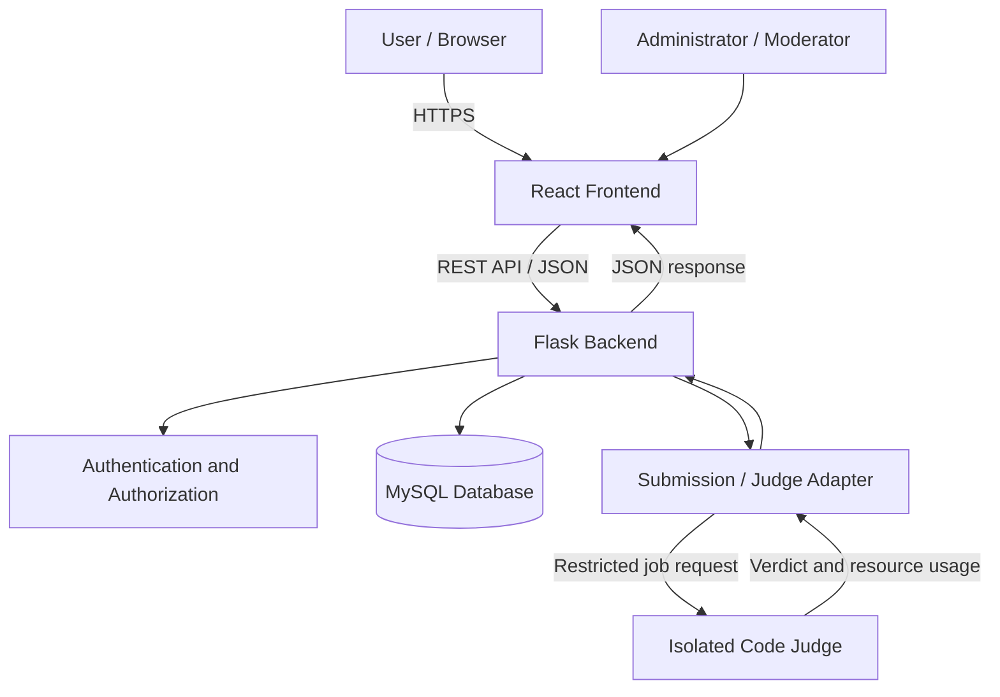
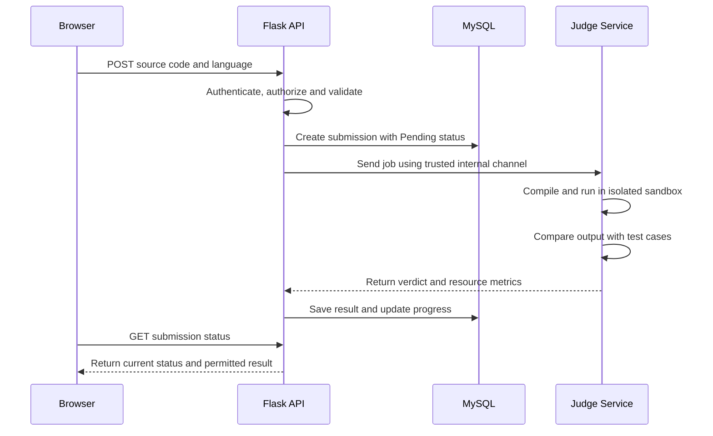

# SCRIPTORIUM — Technical Design Document (TDD)

**Document version:** 1.0  
**Date:** 4 November 2026  
**Status:** Draft for review  
**Product:** SCRIPTORIUM — Code. Connect. Compete.  
**Document owner:** SCRIPTORIUM project team

---

## Document Control

| Field | Details |
|---|---|
| Document name | Technical Design Document |
| File name | `TDD.md` |
| Version | 1.0 |
| Intended audience | Project developers, reviewers, testers and maintainers |
| Related documents | `PRD.md`, `SRS.md`, future `ARCHITECTURE.md`, `DATABASE.md`, `API.md`, `TEST-PLAN.md` |
| Status | Initial technical baseline; implementation choices may be refined |

## 1. Purpose

This Technical Design Document describes how SCRIPTORIUM is intended to be designed and implemented. It converts the product requirements into a practical technical blueprint covering the application structure, technology choices, modules, data flow, database design principles, API conventions, authentication, code execution, security, testing and deployment.

This document is a design guide, not a completed implementation. The project should be developed incrementally, with each component tested before moving to the next.

## 2. Product Overview

SCRIPTORIUM is a web-based developer platform that combines:

1. **Programming community:** users can publish programming questions, write answers, comment, vote, follow tags and participate in technical discussions.
2. **Coding practice:** users can browse programming problems, write code in an online editor, submit solutions, receive judging results and track their progress.
3. **Platform administration:** authorized moderators and administrators can manage users, content, problems, tags and platform activity.

### 2.1 Design goals

- Keep the community and coding-practice experiences within one consistent product.
- Use a modular backend so features can be developed and tested independently.
- Keep the frontend responsive, accessible and maintainable.
- Protect user accounts, content and submitted source code.
- Execute untrusted code only in a dedicated, isolated judging environment.
- Make the first release achievable while leaving room for future expansion.

### 2.2 Non-goals for the initial release

Unless later approved, the initial release will not attempt to provide:
- A general-purpose cloud IDE or persistent development environment.
- Arbitrary package installation or unrestricted internet access during judging.
- Real-money contests, payments or paid subscriptions.
- Native mobile applications.
- Social features unrelated to programming and learning.

## 3. Proposed Technology Stack

The following stack is the recommended baseline. Exact versions should be selected and pinned when implementation begins.

| Layer | Technology | Responsibility |
|---|---|---|
| Frontend | React | Component-based user interface |
| Language | JavaScript initially; TypeScript may be adopted | Frontend application logic |
| Styling | Tailwind CSS or organized CSS modules | Responsive styling and design system |
| Code editor | Monaco Editor or CodeMirror | In-browser source-code editing |
| Backend | Python with Flask | Business logic and REST API |
| Database | MySQL | Persistent relational data |
| ORM / migrations | SQLAlchemy and Flask-Migrate | Database mapping and schema changes |
| Authentication | Secure server-managed sessions or short-lived access tokens with refresh strategy | Identity and access |
| Code judge | Judge0 or a separately maintained sandboxed judge | Compilation and execution of submissions |
| Reverse proxy | Nginx | HTTPS termination and request routing |
| Version control | Git and GitHub | Source control and collaboration |
| Testing | Pytest, React Testing Library, Playwright | Backend, frontend and end-to-end tests |
| Deployment | Linux server or cloud VM/container platform | Hosting and operations |

**Important:** A selected technology is a proposal, not a requirement to use it regardless of circumstances. Before production, review maintenance status, licensing, operational cost and security posture.

## 4. High-Level System Architecture

SCRIPTORIUM will use a client-server architecture. The React application communicates with the Flask API over HTTPS. Flask accesses MySQL for application data. Code submissions are sent to a separate judge service; the Flask web process must never execute submitted code itself.



### 4.1 Main components

**React frontend**
- Renders pages, forms, navigation and dashboards.
- Validates basic input for usability; backend validation remains authoritative.
- Calls API endpoints and displays loading, success and error states.
- Hosts the code editor and submission-result interface.
- Does not contain database credentials, judge secrets or privileged business rules.

**Flask backend**
- Exposes versioned REST endpoints.
- Validates requests and enforces permissions.
- Applies business rules and coordinates database operations.
- Stores problem metadata, submissions and judge results.
- Communicates with the judge through a dedicated adapter.
- Never evaluates user-submitted code inside the Flask process.

**MySQL database**
- Stores users, profiles, questions, answers, comments, votes, tags, problems, test-case metadata, submissions, progress and moderation records.
- Uses foreign keys, unique constraints and indexes to protect data integrity.
- Stores timestamps in a consistent timezone convention, preferably UTC.

**Judge service**
- Receives a validated submission job.
- Compiles and executes code in a disposable isolated environment.
- Applies language, CPU, memory, wall-clock, process, file-system, output and network restrictions.
- Compares program output against test cases and returns a verdict.
- Does not receive unnecessary account or profile information.

## 5. Application Structure

Use a repository structure that keeps frontend, backend, deployment and documentation clearly separated.

```text
scriptorium/
├── frontend/
│   ├── public/
│   └── src/
│       ├── assets/
│       ├── components/
│       ├── features/
│       │   ├── auth/
│       │   ├── community/
│       │   ├── problems/
│       │   ├── submissions/
│       │   ├── profile/
│       │   └── admin/
│       ├── hooks/
│       ├── layouts/
│       ├── pages/
│       ├── services/
│       ├── styles/
│       └── utils/
├── backend/
│   ├── app/
│   │   ├── auth/
│   │   ├── users/
│   │   ├── community/
│   │   ├── problems/
│   │   ├── submissions/
│   │   ├── moderation/
│   │   ├── common/
│   │   ├── models/
│   │   └── services/
│   ├── migrations/
│   ├── tests/
│   ├── config.py
│   └── run.py
├── judge/
│   ├── adapter/
│   ├── configuration/
│   └── documentation/
├── deployment/
│   ├── nginx/
│   └── containers/
├── docs/
│   ├── PRD.md
│   ├── SRS.md
│   ├── TDD.md
│   ├── ARCHITECTURE.md
│   ├── DATABASE.md
│   ├── API.md
│   └── TEST-PLAN.md
├── .gitignore
└── README.md
```

The exact folder layout may evolve. Keep feature-specific code together and avoid placing all application logic in a single file.

## 6. Backend Design

### 6.1 Flask application organization

Use the Flask application-factory pattern and Blueprints to divide the API into feature modules.

| Module | Main responsibility |
|---|---|
| `auth` | Registration, login, logout, session lifecycle and password reset |
| `users` | Profiles, account settings and public user information |
| `community` | Questions, answers, comments, votes and tags |
| `problems` | Problem statements, examples, constraints and supported languages |
| `submissions` | Submission creation, judge status and result retrieval |
| `moderation` | Reports, content review, suspensions and audit records |
| `common` | Shared validation, errors, pagination and utilities |

### 6.2 Backend layering

Each feature should separate responsibilities:

1. **Route/controller:** receives HTTP request, parses input and returns an HTTP response.
2. **Validation/schema:** checks required fields, types, lengths and allowed values.
3. **Service layer:** implements business rules and coordinates operations.
4. **Repository/data access:** performs database queries and persistence.
5. **Model:** represents persistent entities and their relationships.

Routes should remain small. Avoid putting complex business logic or large SQL queries directly inside route functions.

### 6.3 Request lifecycle

1. Browser sends an HTTPS request.
2. Flask identifies the route and HTTP method.
3. Authentication middleware identifies the user, if required.
4. Authorization checks whether that user may perform the action.
5. Input is validated and normalized.
6. Service layer applies business rules.
7. Database transaction is committed when appropriate.
8. API returns a consistent JSON response and suitable HTTP status.

### 6.4 Error handling

Use a consistent response structure.

Example success response:

```json
{
  "success": true,
  "data": {
    "id": 125,
    "title": "Example question"
  }
}
```

Example error response:

```json
{
  "success": false,
  "error": {
    "code": "VALIDATION_ERROR",
    "message": "The title is required.",
    "details": {
      "title": "This field cannot be empty."
    }
  }
}
```

Do not expose stack traces, SQL details, secrets or internal infrastructure information to users. Log diagnostic details securely on the server.

## 7. Frontend Design

### 7.1 Feature-based organization

Build reusable components, but keep feature-specific screens and logic inside their feature folders.

Suggested shared components:
- Header and primary navigation
- Sidebar and responsive mobile navigation
- Buttons, inputs, dropdowns and modal dialogs
- Cards, badges, tabs and pagination
- Loading indicators, empty states and error messages
- Confirmation dialogs and notification/toast messages

### 7.2 Main pages

| Page | Purpose |
|---|---|
| Landing page | Explain SCRIPTORIUM and direct visitors to core features |
| Register / Login | Account access |
| Community feed | Browse recent or popular questions |
| Question detail | Read question, answers and comments |
| Ask question | Publish a question with tags |
| Problem library | Search and filter coding problems |
| Problem detail | Read statement, examples and constraints |
| Code workspace | Select language, edit code and submit |
| Submission detail | View verdict, execution metrics and permitted output |
| User profile | View public profile, activity and progress |
| Leaderboard | Display ranking using a documented scoring rule |
| Admin / moderation | Manage reported content, users and problem records |

### 7.3 Frontend state and API communication

- Keep server data and temporary UI state conceptually separate.
- Centralize API communication in service modules.
- Handle expired sessions and authorization failures consistently.
- Display loading, empty, error and success states for asynchronous operations.
- Do not assume that hiding a button provides security; the backend must enforce permissions.
- Avoid storing sensitive credentials in browser local storage. Prefer secure, HttpOnly cookies for session-based authentication.

### 7.4 Responsive behavior

Design mobile-first or progressively responsive layouts. The code editor may need a different mobile layout, such as stacked editor and problem statement panels. Ensure core community functions remain usable on small screens.

## 8. Database Design Principles

The relational database is MySQL. A detailed schema will be maintained separately in `DATABASE.md`.

### 8.1 Proposed entities

| Entity | Purpose |
|---|---|
| `users` | Login identity, email and role |
| `profiles` | Display name, biography and profile details |
| `questions` | Community questions |
| `answers` | Answers linked to questions and authors |
| `comments` | Comments on supported content |
| `tags` | Reusable topic labels |
| `question_tags` | Many-to-many question/tag relationship |
| `votes` | User votes on supported content |
| `problems` | Coding problem metadata and statements |
| `test_cases` | Judge test-case data and visibility classification |
| `submissions` | Source-code submission and status metadata |
| `submission_results` | Verdict and execution metrics |
| `user_problem_progress` | User's problem-solving state |
| `reports` | User-submitted moderation reports |
| `audit_logs` | Security-sensitive administrative actions |

### 8.2 Data integrity

- Use primary keys for all persistent entities.
- Use foreign keys for relationships.
- Add unique constraints for email and other values that must be unique.
- Prevent duplicate votes using a unique constraint on the voter and target combination.
- Validate enum-like states against an explicit allowed set.
- Use transactions for operations that update multiple related records.
- Define deletion behavior carefully; consider soft deletion for moderated content and auditability.
- Index columns commonly used for lookups, joins, filtering and sorting.

### 8.3 Password storage

Never store plaintext passwords. Use a modern password-hashing algorithm supported by a trusted library, such as Argon2id or bcrypt, with secure parameters. Password reset tokens must be random, short-lived, single-use and stored safely.

## 9. API Design

The backend will expose a versioned REST API under `/api/v1`.

### 9.1 Conventions

- Use nouns for resource paths.
- Use HTTP methods according to their intended semantics.
- Accept and return JSON unless a route explicitly requires another format.
- Validate all incoming data on the server.
- Use pagination for potentially large collections.
- Apply authentication and authorization to protected routes.
- Return consistent error codes and messages.
- Document request and response schemas in `API.md`.

### 9.2 Initial endpoint map

| Method | Endpoint | Purpose |
|---|---|---|
| POST | `/api/v1/auth/register` | Register account |
| POST | `/api/v1/auth/login` | Sign in |
| POST | `/api/v1/auth/logout` | Sign out |
| GET | `/api/v1/users/me` | Current user's profile |
| PATCH | `/api/v1/users/me` | Update current user's profile |
| GET | `/api/v1/questions` | List/search questions |
| POST | `/api/v1/questions` | Create question |
| GET | `/api/v1/questions/{id}` | Get question detail |
| POST | `/api/v1/questions/{id}/answers` | Add answer |
| POST | `/api/v1/questions/{id}/votes` | Vote on question |
| GET | `/api/v1/problems` | Browse problems |
| GET | `/api/v1/problems/{id}` | Get problem detail |
| POST | `/api/v1/problems/{id}/submissions` | Submit code |
| GET | `/api/v1/submissions/{id}` | Get submission status/result |
| POST | `/api/v1/reports` | Report content |

This is an initial route inventory, not a final API contract. Exact fields, response shapes, permissions and status codes belong in `API.md`.

### 9.3 Pagination and filtering

Use a consistent pagination scheme. For example:

`GET /api/v1/questions?page=1&per_page=20&sort=recent&tag=python`

Enforce a maximum page size on the server. Validate sort and filter fields against an allowlist rather than inserting user-provided SQL fragments.

## 10. Authentication and Authorization

### 10.1 Roles

Proposed roles:

- **Guest:** can view public content and problem descriptions where permitted.
- **Registered user:** can ask questions, answer, comment, vote and submit code.
- **Moderator:** can review reports and moderate content within assigned permissions.
- **Administrator:** can manage platform configuration, roles, users and problem content.

### 10.2 Authorization rules

- Apply least privilege.
- Check ownership when users edit or delete their own content.
- Check role permissions for moderation and administration.
- Do not trust role values supplied by the frontend.
- Record sensitive administrative actions in an audit log.
- Revoke sessions or tokens when an account is disabled or credentials are reset, where applicable.

### 10.3 Session security

Use HTTPS everywhere outside local development. For cookie-based sessions, configure `HttpOnly`, `Secure` and appropriate `SameSite` attributes. Protect state-changing requests against CSRF. Apply rate limits to login, registration, password reset and other abuse-prone endpoints.

## 11. Secure Code Execution Design

This is the highest-risk subsystem of SCRIPTORIUM. User-submitted source code is untrusted input.

### 11.1 Mandatory architecture rule

**Never run submitted code inside the Flask application process, on the web server host without isolation, or through a shell command constructed from user input.**

The backend must submit a job to a dedicated judging service that runs each submission inside a disposable, strongly restricted execution environment.

### 11.2 Submission workflow



### 11.3 Job lifecycle

Suggested states:

- `QUEUED`
- `PROCESSING`
- `ACCEPTED`
- `WRONG_ANSWER`
- `TIME_LIMIT_EXCEEDED`
- `MEMORY_LIMIT_EXCEEDED`
- `RUNTIME_ERROR`
- `COMPILATION_ERROR`
- `OUTPUT_LIMIT_EXCEEDED`
- `INTERNAL_ERROR`
- `CANCELLED`

State transitions must be controlled by the backend/judge integration. A client must not be able to mark a submission as accepted.

### 11.4 Sandbox requirements

The judge environment must enforce:
- CPU and wall-clock time limits.
- Memory limits.
- Process and thread limits.
- File-system isolation and restricted writable directories.
- Output-size limits.
- No privileged execution.
- No host filesystem access.
- No Docker socket or host control-socket access.
- Network disabled by default.
- Restricted system calls and capabilities where supported.
- Disposable execution environments and cleanup after each job.
- Resource quotas and queue limits to reduce denial-of-service risk.
- Separate handling of visible and hidden test cases.

The exact implementation depends on the selected judge technology and its documented security model. A container alone is not automatically a sufficient security boundary for hostile code.

### 11.5 Test-case confidentiality

- Hidden test inputs and expected outputs must never be sent to the browser.
- Return only the verdict and explicitly approved feedback.
- Do not include hidden input values in logs visible to users.
- Restrict access to test-case management to authorized problem setters and administrators.
- Protect judge credentials and internal endpoints.

### 11.6 Judge integration reliability

- Use unique submission/job identifiers.
- Make result processing idempotent so duplicate callbacks do not corrupt state.
- Authenticate judge callbacks or use a trusted private network/channel.
- Handle timeouts, retries and unavailable judge services.
- Avoid retrying non-idempotent work without a deduplication key.
- Preserve a clear status when the judge is temporarily unavailable.

## 12. Core Feature Workflows

### 12.1 Community question workflow

1. User opens the question form.
2. Frontend performs basic required-field checks.
3. Backend validates title, body and tags.
4. Backend creates the question and tag relationships in a transaction.
5. Question appears in the community feed.
6. Other users can answer, comment or vote subject to permissions.

### 12.2 Answer and voting workflow

- An answer must reference an existing question and authenticated author.
- Users may edit or delete only content they own, unless moderation permissions apply.
- Voting must be limited to the allowed vote values.
- Enforce one active vote per user per target using database constraints.
- Recalculate or safely maintain vote totals on the server.

### 12.3 Coding problem workflow

1. User browses or searches the problem library.
2. Frontend requests problem metadata and statement.
3. User selects a supported language.
4. Editor initializes with a language-appropriate starter template if available.
5. User submits source code.
6. Backend creates a submission record and queues judging.
7. User sees a pending state and can poll for status.
8. Final verdict and permitted metrics are displayed.
9. User progress is updated according to the product's scoring rules.

## 13. Search, Sorting and Leaderboard

### 13.1 Search

Initial search can use MySQL-supported text search and indexed filters. Search inputs must be parameterized and length-limited. If search volume or relevance needs grow, a dedicated search service can be considered later.

### 13.2 Sorting

Support predictable sort options such as recent, most voted and most answered. Each sort mode must have a stable tie-breaker to avoid inconsistent pagination.

### 13.3 Leaderboard

Define the scoring formula before implementing ranking. The formula should discourage spam submissions and reward meaningful progress. Do not expose private user data. Consider rate limits and anti-abuse checks before awarding points.

## 14. Security and Privacy Controls

| Risk area | Required control |
|---|---|
| SQL injection | ORM/parameterized queries; never concatenate raw user input into SQL |
| Cross-site scripting | Context-aware output escaping; sanitize supported rich text |
| CSRF | CSRF protection for cookie-authenticated state-changing requests |
| Broken access control | Server-side ownership and role checks on every protected operation |
| Credential attacks | Password hashing, rate limiting and secure reset workflow |
| Session theft | HTTPS, secure cookie settings, session rotation and revocation |
| Malicious code | Separate isolated judge with strict resource and network restrictions |
| Data exposure | Minimize returned fields; protect hidden tests and private account data |
| Abuse/spam | Rate limits, reporting, moderation and audit records |
| Secrets leakage | Environment-based secrets; never commit credentials to Git |
| Dependency risk | Pin and update dependencies; review security advisories |
| Operational compromise | Least-privilege service accounts, backups, monitoring and patching |

Collect only information needed to operate the platform. Publish a privacy notice and retention policy before public launch. Restrict access to logs and avoid recording passwords, tokens or unnecessary source-code contents in application logs.

## 15. Performance and Scalability

Initial design priorities:
- Add indexes based on actual query patterns.
- Paginate feeds, problem lists and submission histories.
- Avoid N+1 database query patterns.
- Keep code judging asynchronous relative to normal web requests.
- Apply request-size and upload limits.
- Use caching only for data where invalidation rules are understood.
- Monitor API latency, database performance, judge queue depth and failure rates.
- Scale the API and judge workers independently when required.

Do not optimize prematurely. Measure the real bottleneck before introducing distributed infrastructure.

## 16. Logging and Monitoring

Record structured operational events such as:
- Request identifier, route, status and duration.
- Authentication failures and rate-limit events.
- Important moderation and administrative actions.
- Submission lifecycle transitions and judge errors.
- Database and external-service failures.

Logs must not contain passwords, authentication tokens, hidden test data or other secrets. Define log retention and access permissions. Monitor service health, error rates, queue length, resource usage and backup completion.

## 17. Testing Strategy

Testing will be documented in detail in `TEST-PLAN.md`.

### 17.1 Backend tests
- Unit tests for service-layer business rules.
- API tests for validation, permissions and response contracts.
- Database tests for constraints, relationships and transactions.
- Authentication and authorization tests.
- Judge-adapter tests using a mock judge service.

### 17.2 Frontend tests
- Component tests for forms and reusable UI.
- Feature tests for question creation and code submission.
- Accessibility and responsive-layout checks.
- Error, loading and empty-state tests.

### 17.3 Integration and end-to-end tests
- Register, sign in and sign out.
- Ask a question and submit an answer.
- Vote and prevent duplicate votes.
- Browse a problem and submit code.
- Receive accepted and rejected verdicts from a test judge.
- Verify moderator and administrator permissions.
- Verify hidden test cases are not exposed.

### 17.4 Security testing
- Input validation and injection tests.
- XSS and CSRF tests.
- Access-control and IDOR tests.
- Rate-limit tests.
- Judge sandbox escape and resource-exhaustion review using controlled security test cases.
- Dependency and configuration scans.

## 18. Development and Deployment Environments

Maintain separate environments:

| Environment | Purpose |
|---|---|
| Local development | Individual development and debugging |
| Test / CI | Automated tests and integration checks |
| Staging | Production-like verification before release |
| Production | Public service |

### 18.1 Configuration

- Keep environment-specific configuration outside source code.
- Store secrets in environment variables or a managed secret store.
- Use separate database credentials for development, testing and production.
- Apply schema changes through reviewed migrations.
- Do not use production user data in local development unless properly anonymized and authorized.

### 18.2 Deployment outline

1. Build and test the frontend and backend.
2. Run automated checks in CI.
3. Build deployable artifacts or containers.
4. Apply database migrations with a rollback plan.
5. Deploy the API and frontend behind HTTPS.
6. Deploy judge workers separately with stricter host isolation.
7. Run health checks and smoke tests.
8. Monitor errors, queue depth and service health.
9. Maintain verified backups and periodically test restoration.

## 19. Backup and Recovery

- Back up the database on a defined schedule.
- Encrypt backups at rest and restrict access.
- Store copies separately from the primary server.
- Define recovery point and recovery time objectives before production.
- Test restoration periodically.
- Document how to restore the API, database and judge configuration.
- Do not assume that a successful backup job guarantees a recoverable backup.

## 20. Implementation Phases

| Phase | Deliverables | Exit condition |
|---|---|---|
| 0. Foundation | Repository, environments, design system, Flask setup, React setup, MySQL connection | Application starts locally and basic CI checks pass |
| 1. Accounts | Registration, login, logout, profile and role checks | Account workflows and authorization tests pass |
| 2. Community | Questions, answers, comments, tags and voting | Core discussion workflow works end to end |
| 3. Problem library | Problem CRUD for authorized roles, listing, detail and filtering | Problems can be managed and browsed |
| 4. Judge integration | Submission records, judge adapter, sandbox integration and verdict display | Test submissions are judged safely and reliably |
| 5. Progress and discovery | User progress, search improvements and leaderboard | Progress is correct and ranking rules are documented |
| 6. Moderation and release | Reports, moderation tools, security review, monitoring and deployment | Release checklist and acceptance tests pass |

Develop each phase in small, reviewable tasks. Do not begin by implementing every feature simultaneously.

## 21. Key Technical Decisions and Open Questions

The following decisions must be finalized before the relevant implementation phase:

1. **Editor:** Monaco Editor or CodeMirror, considering bundle size, language support and usability.
2. **Judge:** Judge0 or another judge service; evaluate isolation model, supported languages, operational requirements and licensing.
3. **Authentication:** server-side sessions or token-based authentication; choose one deliberately and implement its security controls correctly.
4. **Deployment:** single server for early development versus separate managed services for production.
5. **Rich text:** plain Markdown with safe rendering versus a richer editor.
6. **Supported languages:** begin with a small tested set and expand only after judge images and test coverage are ready.
7. **Leaderboard formula:** define transparent rules and anti-abuse measures.
8. **Content retention:** determine deletion, soft-deletion and moderation retention policies.
9. **Notifications:** decide whether the first release uses in-app notifications only or adds email.
10. **Club identity:** confirm whether the platform is officially connected to the Scriptorium club at Akal University or is an independent project using the same name.

## 22. Technical Risks and Mitigations

| Risk | Impact | Mitigation |
|---|---|---|
| Unsafe code execution | Critical security compromise | Dedicated sandbox, strict isolation, resource limits and security review |
| Judge service outage | Users cannot receive verdicts | Queue jobs, show clear status, retry safely and monitor availability |
| Poor database design | Data inconsistency and expensive changes | Schema review, constraints, migrations and tests |
| Feature scope grows too quickly | Delayed delivery | Phase-based releases and explicit MVP boundaries |
| Unauthorized content changes | Loss of trust and data integrity | Server-side authorization, audit logs and tests |
| Spam and abusive content | Community quality declines | Rate limits, reporting and moderation workflow |
| Secrets committed to repository | Account or infrastructure compromise | Secret management, scanning and rotation procedures |

## 23. Definition of Done

A feature is not complete merely because it works on the developer's machine. Before a feature is considered complete:

- Requirements and acceptance criteria are understood.
- Backend validation and authorization are implemented.
- Frontend loading, success, empty and error states are handled.
- Relevant unit and integration tests pass.
- Database migrations are included where needed.
- No secrets or sensitive data are exposed.
- Accessibility and responsive behavior have been checked.
- Documentation is updated.
- Code is reviewed and merged through version control.

## 24. Relationship to Other Documents

| Document | Responsibility |
|---|---|
| `PRD.md` | Product vision, users, goals, scope and priorities |
| `SRS.md` | Detailed functional and non-functional requirements |
| `TDD.md` | Technical implementation design and engineering decisions |
| `ARCHITECTURE.md` | Deeper component boundaries, deployment topology and interactions |
| `DATABASE.md` | Detailed relational schema, constraints and indexes |
| `API.md` | Endpoint contracts, request/response schemas and error codes |
| `UI-UX.md` | Wireframes, visual system and interaction behavior |
| `TEST-PLAN.md` | Test cases, coverage and release verification |
| `README.md` | Developer setup, commands and contribution instructions |

## 25. Change Control

This document is a living technical baseline. Update it when a major architectural decision, technology, security boundary, data flow or deployment model changes. Record significant decisions with the reason, alternatives considered and consequences. Keep the TDD, SRS, API and database documentation consistent.

---

**End of Document — SCRIPTORIUM TDD v1.0**
